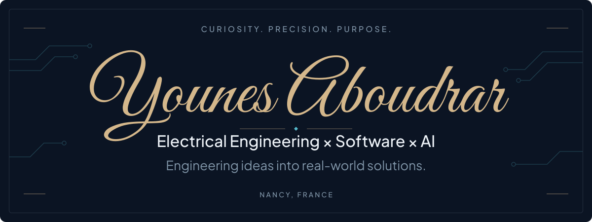

<picture>
  <source media="(max-width: 600px)" type="image/svg+xml" srcset="assets/signature-header-mobile.svg">
  <source type="image/svg+xml" srcset="assets/signature-header.svg">
  
</picture>

  <a href="https://younes.aboudrar.dev">Portfolio</a> ·
  <a href="https://github.com/Younes-Aboudrar?tab=repositories">Projects</a> ·
  <a href="mailto:aboudraryns@gmail.com">Email</a> ·
  <a href="https://www.linkedin.com/in/younes-aboudrar/">LinkedIn</a>

> **Open to a 6-month final-year engineering internship (PFE) starting March 2027.**

I'm **Younes**, a final-year Electrical Engineering student at ENSEM Casablanca, currently on exchange in Digital Systems Engineering at **ENSEM Nancy — Lorraine INP, Université de Lorraine**, France.

I connect an electrical engineering foundation with software development and applied AI. My projects explore practical ways to make technical knowledge accessible, connect services, and turn ideas into usable tools.

## Featured engineering projects

### 01 · [AI Engineering FAQs Chatbot](https://github.com/Younes-Aboudrar/CodeAlpha_AIEngineeringFAQsChatbot)

**Making AI engineering knowledge easier to navigate.** A Flask chatbot retrieves answers from a structured FAQ knowledge base using spaCy similarity, with a TF-IDF fallback. Conversation history supports follow-up questions.

`Python` `Flask` `spaCy` `NLP` `TF-IDF`

### 02 · [Multilingual Translation Platform](https://github.com/Younes-Aboudrar/CodeAlpha_LanguageTranslationTool)

**Bringing translation and spoken output into one interface.** A browser application integrates Microsoft Azure Translator for multilingual translation and automatic source-language detection. Text-to-speech uses the browser's Web Speech API and available voices.

`JavaScript` `HTML / CSS` `Azure Translator` `Web Speech API`

### 03 · [AéroENSEM Website](https://github.com/Younes-Aboudrar/aeroensem_website)

**Giving the student aviation club a shared presence online.** A Hugo website introduces the club and highlights its aeronautics event. Markdown content and a GitHub Actions deployment workflow support ongoing updates to GitHub Pages.

`Hugo` `Markdown` `GitHub Actions` `GitHub Pages`

### 04 · [Personal Portfolio](https://github.com/Younes-Aboudrar/portfolio)

**Making an engineering background easy to explore.** A bilingual French/English portfolio built with SvelteKit and TypeScript organizes projects, education, experience, and contact information, with a printable CV drawn from the same content.

`TypeScript` `SvelteKit` `Tailwind CSS` · [Visit the portfolio →](https://younes.aboudrar.dev)

## Technical expertise

**Demonstrated in the projects above**

- **Applied NLP & Python services** — Python, Flask, spaCy, text preprocessing, similarity-based FAQ retrieval, and JSON knowledge bases.
- **Web interfaces & API integration** — JavaScript, TypeScript, HTML/CSS, SvelteKit, HTTP requests, Azure Translator, and browser speech synthesis.
- **Publishing & development workflow** — Git/GitHub, Hugo, Markdown, and GitHub Actions for static-site deployment.

**Academic foundations**

Electrical engineering, digital systems, MATLAB/Simulink, PID control, and data analysis. My [portfolio](https://younes.aboudrar.dev) separates coursework and simulations from personal and professional projects.

## GitHub activity

Explore my **contribution graph and activity timeline** in [GitHub's native profile overview](https://github.com/Younes-Aboudrar?tab=overview), alongside the [repositories behind the work](https://github.com/Younes-Aboudrar?tab=repositories). On my profile, GitHub displays the live contribution graph below this README and the pinned repositories.

## Let's build something useful

Have a software, AI, automation, or digital engineering problem to work through? I'm interested in conversations with engineering teams, founders, and collaborators who want to turn a clear need into a working solution.

For **PFE opportunities from March 2027**, technical collaborations, or a project conversation:

**[aboudraryns@gmail.com](mailto:aboudraryns@gmail.com)** 
[Portfolio](https://younes.aboudrar.dev) · [LinkedIn](https://www.linkedin.com/in/younes-aboudrar/) · [GitHub](https://github.com/Younes-Aboudrar)
